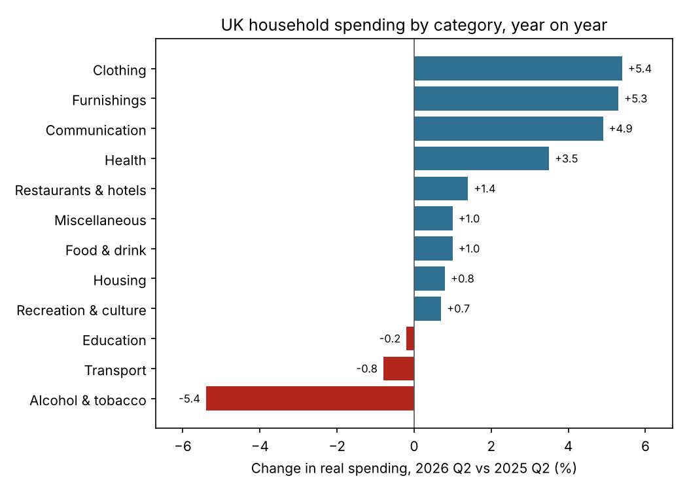
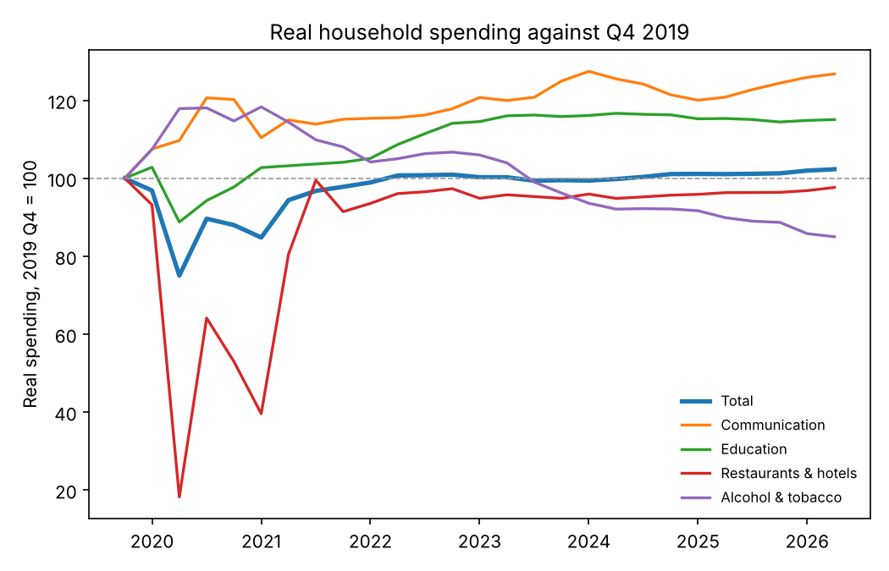

# UK household spending by category

A small analysis of how real UK household spending is moving, by category, using the Office for National Statistics (ONS) quarterly release.

**Latest quarter (2026 Q2):** total real spending is up 1.2% on a year earlier and 0.3% on the previous quarter. Clothing (+5.4%) and furnishings (+5.3%) grew fastest. Alcohol and tobacco (-5.4%) fell most.




## Data

- Source: ONS, *Consumer trends, UK: April to June 2026*, released 30 September 2026.
- Series: household final consumption expenditure, chained volume measure (2024 prices), seasonally adjusted, £ million. Worksheet 0KS, quarterly table.
- File: `data/ons_household_spending.csv` holds 2019 Q4 to 2026 Q2 for the total and the 12 COICOP groups, copied unchanged from the ONS workbook.
- ONS publishes these figures about 90 days after each quarter ends, and revises them under the National Accounts revisions policy.

## Method

For each category, `analysis.py` divides the latest quarter by the previous quarter, by the same quarter a year earlier, and by 2019 Q4, and reports the percentage change to one decimal place. The line chart indexes each category to 2019 Q4 = 100. Lines are drawn point to point.

## Run it

```
pip install -r requirements.txt
python analysis.py
```

This prints the table and writes `data/growth_by_category.csv` and the two charts in `charts/`.

## Limits

- These are national-accounts estimates, not card or bank transaction data.
- The categories are broad COICOP groups, so they hide differences inside each group.
- Quarterly data cannot show what happened inside a quarter.

## Credit

Built with help from Claude (Anthropic) for the data extraction, analysis and charts. The ONS data is published under the Open Government Licence.
